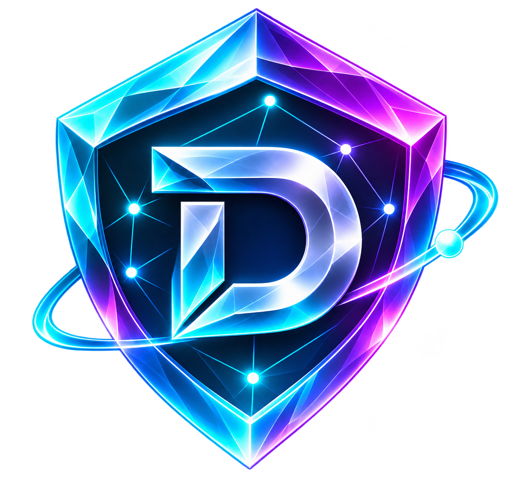
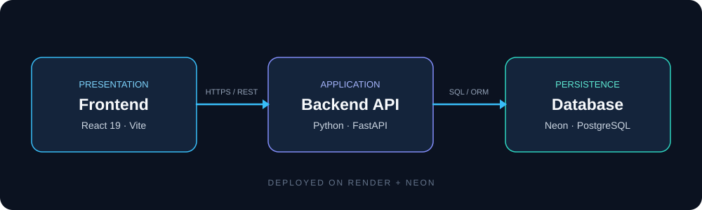

<div align="center">





<br>

[](https://deeprisk-frontend.onrender.com)
[](https://deeprisk.onrender.com/docs)
[](https://neon.tech)

<br>

### See the risk. Understand the graph. Secure the stack.

**An Explainable Software Supply-Chain Security Platform**

[Live Application](https://deeprisk-frontend.onrender.com) · [API Documentation](https://deeprisk.onrender.com/docs)

</div>

---

## ◈ About Deep Risk

Deep Risk is a software supply-chain security platform designed to analyze npm dependencies, identify known vulnerabilities, assess dependency risk, and generate structured security reports.

It combines dependency analysis, vulnerability intelligence, explainable risk prioritization, interactive dependency visualization, and persistent scan history in one unified platform.

**The mission:** Make software dependency risks easier to discover, understand, and prioritize.

## ✦ Core Features

| Capability | Description |
|---|---|
| 🔍 Dependency Analysis | Parse npm lockfiles and identify project dependencies. |
| 🛡️ Vulnerability Intelligence | Retrieve and cross-check vulnerability information using OSV and enrichment sources. |
| 🕸️ Dependency Graph | Explore package relationships through interactive graph visualization. |
| 📊 Risk Prioritization | Evaluate findings using explainable risk-scoring logic. |
| ⚠️ Security Findings | Review identified vulnerabilities and their severity. |
| 🐙 GitHub Scanning | Scan supported GitHub repositories. |
| 📁 Scan History | Persist and review previous scan records. |
| 📄 Security Reports | Generate structured JSON reports. |
| 🧰 Remediation Guidance | Explore remediation information for identified risks. |
| ⚡ REST API | Access scanning, configuration, health, and reporting capabilities. |
| 🖥️ Web Dashboard | Explore repositories, findings, reports, and scan history. |


## ⌘ System Architecture


<div align="center">



</div>

### Application Flow

`Browser → React 19 + Vite (Render) → HTTPS / REST API → Python + FastAPI (Render) → SQLAlchemy → Neon PostgreSQL`

## 🛠 Technology Stack


| Layer | Technologies |
|---|---|
| Frontend | React 19, Vite, JavaScript, CSS |
| Visualization | Recharts, Cytoscape, 3D Force Graph, Three.js |
| Backend | Python 3.12, FastAPI, Uvicorn |
| Database | Neon PostgreSQL, SQLAlchemy |
| Migrations | Alembic |
| Testing | Pytest |
| Code Quality | Ruff, Oxlint |

## 🚀 Live Deployment

[](https://deeprisk-frontend.onrender.com)

| Service | URL |
|---|---|
| Frontend | https://deeprisk-frontend.onrender.com |
| Backend | https://deeprisk.onrender.com |
| API Docs | https://deeprisk.onrender.com/docs |
| Database | Neon PostgreSQL |

**Deployment architecture:** React frontend and FastAPI backend hosted on Render, with Neon PostgreSQL for persistent storage.

> Note: Render free-tier services may experience a cold start after inactivity.

## ⚙️ Local Development Setup

### Prerequisites
- Python 3.12+
- Node.js and npm
- Git
- PostgreSQL or SQLite

### 1. Clone Repository
```bash
git clone https://github.com/HarshKamboj25/Deeprisk.git
cd Deeprisk
```

### 2. Backend Setup
```bash
cd backend
python -m venv .venv
```

Activate the virtual environment, then install dependencies:

```powershell
.\.venv\Scripts\Activate.ps1
pip install -e ".[postgres,dev]"
```

For SQLite development, use `pip install -e ".[sqlite,dev]"` instead.

Configure `DEPRISK_DATABASE_URL` for your selected database.

### 3. Database Migration
```bash
alembic -c alembic.ini upgrade head
```

### 4. Start Backend
```bash
uvicorn deprisk.api.app:app --reload
```
Backend: `http://127.0.0.1:8000`

### 5. Start Frontend
```bash
cd frontend
npm ci
npm run dev
```
Frontend: `http://localhost:5173`

Set `VITE_API_BASE_URL` when using a custom backend URL.

## 🔌 API Endpoints

| Method | Endpoint | Description |
|---|---|---|
| GET | `/health` | API health check |
| GET | `/health/ready` | Database readiness |
| GET | `/api/v1/configuration` | Workspace configuration |
| POST | `/api/v1/scans` | Submit repository scan |
| GET | `/api/v1/scans` | Scan history |
| GET | `/api/v1/scans/{scan_id}` | Scan status |
| GET | `/api/v1/scans/{scan_id}/report` | Scan report |
| GET | `/api/v1/repositories` | Registered repositories |

## 🧪 Testing & Quality

Backend tests:
```bash
pytest
ruff check src tests
```

Frontend checks:
```bash
npm run lint
npm run build
```

## 🔐 Security

- Never commit `.env` files or private credentials.
- Keep GitHub authentication tokens in secure backend environment variables.
- Use a properly configured database for persistent deployments.
- Configure local workspace access explicitly before enabling local scanning.

## 📌 Project Status

**Core application deployed and operational.**

Frontend, backend, and database connectivity have been verified in the deployed environment.

## 📄 License

A license has not yet been specified. All rights reserved unless a license is added to this repository.

---

<div align="center">


**DEEP RISK**

*Making software supply-chain security easier to understand.*

[Live Application](https://deeprisk-frontend.onrender.com) · [API Documentation](https://deeprisk.onrender.com/docs)

</div>


